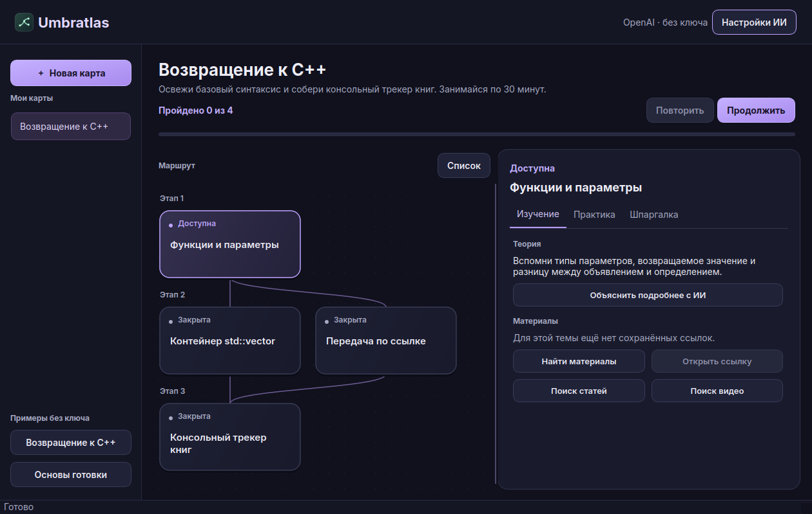

# Umbratlas

Настольное приложение для Fedora KDE, которое превращает учебную цель в интерактивную карту с практикой и шпаргалками. Можно вернуться к C++ после годового перерыва, начать готовить или выбрать другой навык. Название соединяет латинское *umbra* («тень») и *atlas* («атлас»).



## Оформление

Тема **Lavender Night**: чернильный фон, лавандовые акценты и сине-фиолетовые карточки. Точечная сетка помогает ориентироваться в графе; подсветка выделяет выбранную тему, а полоса над картой показывает прогресс.

## Как работает

1. **Выбери цель.** Опиши, чему хочешь научиться. ИИ задаст обычно 3–5 вопросов об опыте, времени и желаемом результате, максимум 17. Вопросы показываются по одному; ответы сохраняются автоматически.
2. **Открой карту.** Темы сгруппированы по этапам, линии показывают зависимости. Нажми карточку, чтобы открыть объяснение, задание и шпаргалку. Кнопка «Список» переключает представление.
3. **Подбери материалы.** Нажми «Найти материалы» в доступной теме. Приложение запускает веб-поиск по запросу и сохраняет ссылки из результатов. Язык материалов можно изменить в настройках.
4. **Закрепи тему.** Выполни задание, запиши результат и сверься с критериями или попроси ИИ оценить ответ. Успешная практика открывает зависимые темы.
5. **Вернись после паузы.** После отсутствия от 7 дней автоматически появится вопрос для восстановления знаний. Ответь и попроси ИИ составить короткий план возвращения; без ключа доступна шпаргалка. «Продолжить» открывает следующую доступную тему. «Повторить» показывает вопрос для самопроверки и затем шпаргалку. Интервал растёт от 1 до 30 дней при успешных повторениях.

В приложении есть два примера, **«Возвращение к C++»** и **«Готовка на каждый день»**. Они открываются без ключа, поддерживают самопроверку, сохранение прогресса и повторение. Генерация новых карт и проверка с ИИ требуют интернет и свой ключ. Кнопки поиска статей и видео открывают встроенную страницу и доступны без ключа.

## Установка на Fedora KDE

### RPM (рекомендуется)

Скачай `umbratlas-0.3.1-1.noarch.rpm` на [странице релиза](https://github.com/DarolCup/umbratlas/releases/tag/v0.3.1), затем:

```bash
sudo dnf install ./umbratlas-0.3.1-1.noarch.rpm
umbratlas
```

DNF установит Python и Qt. Приложение появится в меню KDE. Пакет `noarch` содержит Python-код и использует системный Qt; это не автономный бинарник. Системная установка не меняет пользовательскую базу.

### Одной командой

Скрипт из тега v0.3.1 скачивает архив релиза, сверяет SHA-256, при необходимости предлагает установить системный пакет Qt через DNF и добавляет Umbratlas в меню KDE.

```bash
curl -fsSL https://raw.githubusercontent.com/DarolCup/umbratlas/v0.3.1/install.sh | bash
```

Посмотреть перед запуском можно [здесь](https://github.com/DarolCup/umbratlas/blob/v0.3.1/install.sh). Архив и контрольная сумма также доступны на [странице релиза](https://github.com/DarolCup/umbratlas/releases/tag/v0.3.1).

После установки открой **Umbratlas** в меню приложений KDE или запусти `~/.local/bin/umbratlas`. Установка приложения происходит в пользовательский каталог. Права администратора нужны только для установки недостающих системных зависимостей.

### Из исходников

```bash
sudo dnf install git python3 python3-pyside6
git clone https://github.com/DarolCup/umbratlas.git
cd umbratlas
python3 -m umbratlas
```

Чтобы добавить ярлык в KDE из уже скачанных исходников, выполни `bash install.sh` в каталоге проекта. Можно также распаковать архив релиза и выполнить те же две команды запуска или установки внутри каталога `umbratlas-0.3.1`.

## Один экран, весь маршрут

Все учебные формы, настройки, сообщения об ошибках и чат с учителем находятся внутри главного окна. Статьи и видео тоже открываются внутри приложения через Qt WebEngine; сайт или кодеки могут ограничивать воспроизведение отдельных видео. Адрес можно скопировать для открытия вручную.

В графе можно перетаскивать поле и менять масштаб через **Ctrl + колесо**. Необязательные темы помечаются «дополнительно» и не блокируют основной маршрут. Старые карты считаются обязательными; новые генерируются с дополнительными ветками. «Продолжить» выбирает сначала доступную обязательную тему.

Нажми **«Объяснить подробнее с ИИ»** в доступной теме: учитель разберёт теорию и пример, а затем ответит на уточняющие вопросы. История этого разговора действует до выхода из экрана учителя. Карта, практика, найденные материалы и черновики ответов сохраняются между запусками.

## Подключение ИИ

Открой **«Настройки ИИ»** и выбери, к кому подключаться.

| Провайдер | Настройка |
| --- | --- |
| **OpenAI** | Введи [ключ OpenAI](https://platform.openai.com/api-keys). По умолчанию используется [`gpt-5.4-mini`](https://developers.openai.com/api/docs/models/gpt-5.4-mini) через Responses API. |
| **GhostModel** | Введи ключ из кабинета GhostModel. Адрес `https://ghostmodel.cc/v1` заполнится автоматически. Выбери Chat Completions или Responses API по возможностям модели. [Документация GhostModel](https://ghostmodel.cc/docs) |
| **Другой провайдер** | Введи HTTPS Base URL из документации, например `https://provider.example/v1`. Выбери поддерживаемый протокол и введи ключ этого сервиса. |

Нажми **«Загрузить модели»** и выбери текстовую модель. Если каталог недоступен, введи её точный ID вручную. **«Проверить модель»** отправляет короткий запрос с твоим ключом и проверяет, можно ли прочитать ответ. Такой запрос может расходовать токены. Для GhostModel можно начать с `gpt-6-luna` через Chat Completions. При явном отказе GhostModel по выбранному протоколу приложение пробует второй протокол.

Для автоматического подбора ссылок через Responses API модель и провайдер должны поддерживать инструмент `web_search`. Если для карт выбран Chat Completions, укажи в поле **«Модель для поиска»** ID подходящей модели того же провайдера. Для GhostModel в первую очередь можно попробовать `gpt-6.1-sol`, в карточке которой указан веб-поиск. Кнопки **«Поиск статей»** и **«Поиск видео»** открывают встроенную страницу независимо от протокола. [Карточка GPT-6.1 Sol](https://ghostmodel.cc/model/gpt-6.1-sol)

При обрыве соединения или тайм-ауте Umbratlas показывает причину и сохраняет цель и отправленные ответы диагностики. После перезапуска открой **«К диагностике»**, чтобы продолжить с черновика. Длинный ответ при создании карты может занять несколько минут. Платный запрос после обрыва автоматически не повторяется.

Ключ действует до закрытия приложения. При запуске из терминала можно использовать `OPENAI_API_KEY` или `GHOSTMODEL_API_KEY` для соответствующего профиля. Цель, ответы диагностики и текст решения передаются выбранному провайдеру при соответствующем запросе. Тарифы и лимиты зависят от провайдера. При проверке ИИ оценивает переданный текст. Код запускай в своей среде, а результат физических заданий сверяй по критериям.

## Данные и разработка

Umbratlas использует Python, Qt Widgets через PySide6 и SQLite. Интерфейс рисует карту из структурированных данных. Сетевые запросы выполняются в фоновом потоке, а карты, найденные ссылки, попытки и расписание повторений сохраняются локально. Для сетевых запросов используется стандартная библиотека Python.

- База и настройки находятся в путях XDG. База по умолчанию находится в `~/.local/share/Umbratlas/Umbratlas/learning.sqlite3`. Для резервной копии закрой приложение и скопируй файл базы.
- Путь для команды можно переопределить через `UMBRATLAS_BIN_DIR` при установке. Установленные файлы приложения находятся в `${XDG_DATA_HOME:-$HOME/.local/share}/umbratlas`.
- Тесты проверяют сохранение прогресса, разблокировку веток, повторение, оконный сценарий и обработку ответов API без платных запросов.

```bash
QT_QPA_PLATFORM=offscreen python3 -m unittest discover -s tests -v
```

## Сборка релиза

```bash
sudo dnf install rpm-build python3-pyside6
QT_QPA_PLATFORM=offscreen python3 -m unittest discover -s tests -v
python3 scripts/build_release.py --rpm
```

Архив исходников, RPM и контрольные суммы появятся в `dist/`. Без `--rpm` создаётся только архив. GitHub Actions проверяет сценарии и публикует релиз новой версии при обновлении `main`; уже существующий релиз не перезаписывается.

Проверены тестовые ответы обоих API-протоколов, ошибки соединения, предел диагностики, единственное окно, зависимости тем, восстановление черновиков и повторение. Реальные ответы, стоимость и доступность поиска зависят от выбранного сервиса; приложение не получает API-ключ автоматически.
